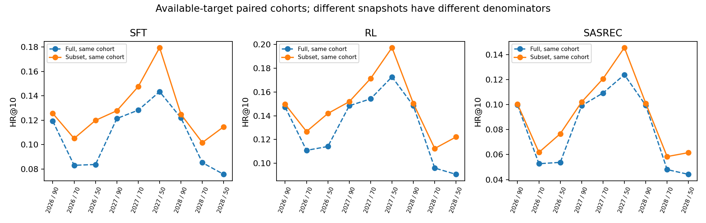

# MiniOneRec：动态目录与 CSR 约束解码

为 MiniOneRec 增加可切换目录的约束解码后端：在生成过程中限制合法 SID，采用 CSR 数组和批量张量操作代替逐候选前缀查询。

**项目贡献聚焦两点：动态推荐目录、CSR 张量化约束解码。**保留官方目录和训练入口，提供参数开关、独立接口、可运行示例及针对这两项功能的实验结果。模型与基线用于评估约束正确性和性能收益。

核心思想受 [STATIC 论文](https://arxiv.org/abs/2602.22647)启发，本项目将其稀疏状态转移思路适配到 MiniOneRec / PyTorch。原方法与实现可参阅 [STATIC 作者仓库](https://github.com/youtube/static-constraint-decoding)。

## 1. 实现原理

MiniOneRec 通过逐 token 生成商品的语义标识符（SID）完成推荐。为保证结果对应合法商品，官方参考实现建立“前缀 → 合法下一 token”的映射，在束搜索中逐条查询候选前缀，并屏蔽非法 token。

这种方式需要逐束执行 Python 查询；当前序列位于 GPU 时，将前缀转换为列表还可能引入设备同步和数据传输，增加约束处理开销。

受 STATIC 启发，本项目采用 **CSR 张量化约束解码**：先在 CPU 上合并合法 SID 路径的公共前缀，再按节点排列出边，构建三个数组：

| 数组 | 作用 |
|---|---|
| `row_ptr` | 定位每个节点的出边区间 |
| `token_ids` | 保存出边对应的合法 token |
| `next_nodes` | 保存选择 token 后到达的节点 |

如下图所示，前缀 `[1]` 对应节点 1，其出边区间为 `[2,4)`。读取 `token_ids[2:4]` 即得到合法下一 token `{3,4}`，对应的后继节点由 `next_nodes[2:4]` 给出。


生成时，后端在 GPU 上批量查询多个候选束的转移关系，再统一构造掩码：

$$
\widetilde{\ell}_v =
\begin{cases}
\ell_v, & v \in \mathcal{A}_c(p),\\
-\infty, & \text{其他}.
\end{cases}
$$

其中，$\ell_v$ 为模型的 log-softmax 分数，$\mathcal{A}_c(p)$ 为目录 $c$ 下前缀 $p$ 的合法下一 token 集合。

该实现保持合法集合和评分规则一致，将逐束 Python 查询转换为批量张量操作，减少主机侧调度与部分同步开销，使约束计算更适合 GPU。目录索引可重复使用；每步解码仍包含前缀遍历与稠密掩码构造。性能实验分别测量约束模块、完整生成和 RL 更新的耗时，呈现优化在不同计算范围内的实际收益。

**动态目录用于验证 CSR 约束解码的正确性、适用性与性能。**实验固定模型和用户历史，切换允许推荐的 SID 子集，并为各目录构建独立索引；检查不可用商品的屏蔽情况，对比两种后端的输出与耗时，同时在目标仍可用的相同请求上配对计算推荐指标，分析候选目录变化的影响。

本项目将 STATIC 的稀疏状态转移思路适配到 MiniOneRec/PyTorch 的束搜索流程，提供可切换的 CSR 约束解码接口。

## 2. 已取得的效果

### CSR 解码性能


图中三个面板均比较 **参考约束后端与 CSR 约束后端**。两者使用同一合法目录并执行约束生成，计时对照检查了输出一致性。

| 测量范围 | 参考约束 | CSR 约束 | 耗时降低 |
|---|---:|---:|---:|
| 约束回调（同步插桩） | 933.68 ms | 107.09 ms | 88.53%（约8.72×） |
| 完整生成（beam50，报告聚合范围） | 3.32046 s | 2.49001 s | 25.01% |
| 完整 RL 更新（主 A/B，均值） | 8.33675 s/update | 8.18524 s/update | 1.82% |

前两项来自48条代表性请求的同一评估报告。同步插桩用于定位约束模块开销，无插桩计时用于测量完整生成，两种测量各自报告后端间的耗时变化。第三项取预热后10次更新的均值；交换运行顺序后复测耗时降低1.70%，因此报告训练侧短测收益范围为 **1.70%～1.82%**。各面板使用独立坐标轴，并分别标明计时范围、单位和聚合口径。

完整生成包含约束查询、模型前向和束搜索；完整 RL 更新进一步包含奖励、概率计算、反向传播及优化器更新。约束计算在各流程中的耗时占比决定整体收益，因此分别报告模块、生成和更新三个层级的实测结果。以上数字来自本项目适配实现的服务器实验。

$$
\mathrm{Speedup}=\frac{T_{\mathrm{reference}}}{T_{\mathrm{CSR}}},\qquad
\mathrm{Reduction}=1-\frac{T_{\mathrm{CSR}}}{T_{\mathrm{reference}}}.
$$

保留数字证据及绘图脚本：

```bash
python scripts/plot_results.py
python examples/benchmark_generation.py --help
```

性能 A/B 输入、索引构建、缓存排除和一致性要求见 [评估协议](docs/evaluation_protocol.md)。生成侧收益采用完整生成计时，训练侧收益采用完整 RL 更新短测计时。

### 动态目录约束效果

使用既有固定模型，三个随机种子 × 90%/70%/50% 保留比例；每个目录保留全部 **4533 条请求**检查约束。SFT、RL、SASRec 均未输出不可用 SID；SFT/RL 返回完整 Top-50，SASRec 的6条空历史请求保留为不足案例。



图中每对点使用同一目标可用请求集合；不同目录的可用请求数量分别统计。模型权重保持固定，配对指标反映候选集合缩小后推荐结果的变化。

## 3. 代码结构

| 模块 | 职责 |
|---|---|
| `evaluate.py`、`rl.py`、`minionerec_trainer.py` | 原入口接入、rollout/验证处理器与索引复用 |
| `constraint_backend.py`、`csr_decode.py` | 后端选择、前缀检查与独立 `CSRLogitsProcessor` 接口 |
| `src/decoding/` | CSR 索引、张量查询、分数掩码与参考后端 |
| `catalog_tools.py` | 嵌套目录快照与配对指标 |
| `examples/`、`tests/` | 接入示例、生成 A/B 与功能测试 |

基于 MiniOneRec 提交 `526306229326013a7ca46f5b2d8f55ea669aa159`，保留上游 SFT、RQ 与数据处理流程。参见[上游说明](docs/upstream_readme.md)。

## 4. 依赖与接入

依赖见 `requirements-csr.txt`（Transformers 4.57.1）；上游训练依赖见 `requirements.txt`。

`evaluate.py`、`rl.py` 通过 `--constraint_backend csr` 启用 CSR，默认 `reference`。训练与解码参数沿用现有配置；当前接入 Transformers 常规生成路径，vLLM 路径会触发兼容性错误。

独立使用：

```python
from transformers import LogitsProcessorList
from csr_decode import CSRLogitsProcessor

processor = CSRLogitsProcessor(paths, tokenizer.eos_token_id, device=model.device)
outputs = model.generate(
    **inputs, **generation_kwargs,
    logits_processor=LogitsProcessorList([processor]),
)
```

`paths` 为响应 token 路径，包含响应结束符及最终 EOS；模型与目录使用一致的 tokenizer。索引可复用，每次生成使用独立处理器。详见[接入说明](docs/integration.md)。

功能检查：

```bash
python -m unittest tests.test_csr_decode tests.test_backend_selection
```

## 5. 目录与评估接口

`catalog_tools.py create` 按固定种子生成 90%/70%/50% 嵌套 SID 快照；`evaluate` 对完整目录与子目录预测进行配对评估。

- **目录粒度**：唯一 SID；碰撞商品按 SID 组处理。每份快照重建索引，请求期间固定目录版本，保留用户历史。
- **输入约定**：SID 字符串列表；预测记录为 `{request_id, output, predict}`，两组预测的请求顺序与目标一致。
- **评估口径**：全部请求检查约束与 Top-K 完整性，目标可用的同一请求集合计算配对 HR/NDCG。

参数示例见 `examples/catalog_demo.py`，数据与计时约定见[评估协议](docs/evaluation_protocol.md)。

## 6. 验证与来源

已完成 CPU 接口测试和参数接线检查；改后的原入口与公共基准 CLI 的 **GPU 验收待完成**。结果图引用此前服务器实验记录，`results/` 与 `scripts/plot_results.py` 支持重绘；逐请求指标复算需提供预测文件。

保留 MiniOneRec 上游代码与许可，CSR 约束解码借鉴 STATIC 的稀疏转移思路。代码与资源归属见[第三方说明](THIRD_PARTY_NOTICES.md)。
